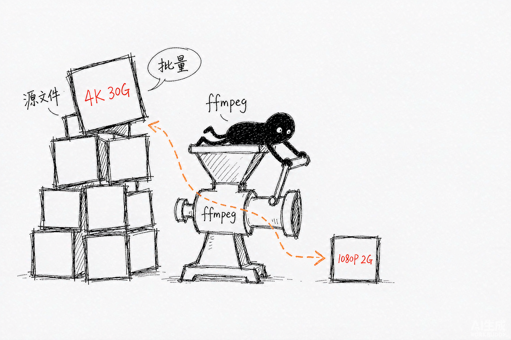
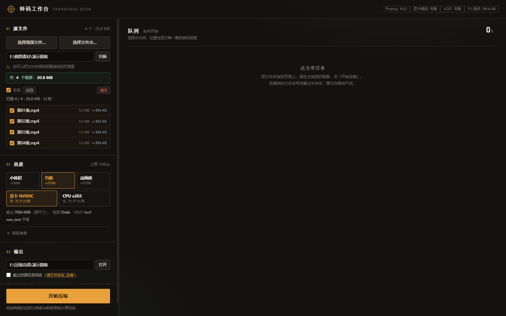

# Video Compress Console · 视频压缩控制台

一个跑在本机的 ffmpeg 批量转码控制台：**零依赖**（不用 `npm install`）、**无构建步骤**、双击即用。
把整个剧集文件夹丢进去，它逐文件算出该用的码率，排队压完，跑完的自动折起来。



## 它解决什么问题

压视频这件事，难的不是压一个，而是**压一批**：

| 痛点 | 这里的做法 |
|---|---|
| ffmpeg 参数记不住 | 画质三档 + 自动码率，参数在「高级参数」里可查可改 |
| 码率给多少全靠猜 | 按 `像素数 × 帧率 × bpp` 逐文件计算，锚点实测 PSNR 46.6 dB |
| 一压一整晚，不知道进度 | SSE 实时推送，每集一段胶片进度条，完成自动折叠 |
| 输出目录乱 | 集中输出，或勾选后自动建在源目录同级的 `xxx_压缩` |
| 4K 文件太大传不上来 | 按短边上限只降不升，源文件始终保持不动 |
| 命令行选文件太痛苦 | 系统选择框、拖拽文件夹、拖拽单文件都支持 |
| 重跑一批把已有结果覆盖了 | 同名默认**跳过**，也可改成自动加 `(1)` 或明确覆盖 |
| 参数调半天，不知道压出来啥样 | 单个文件「试压」前 15 秒，几十秒就能验证一整套参数 |
| 压了两小时，忘了去看 | 跑完发系统通知 + 可选提示音，标签页也可以放着不管 |
| 一屏几十集，找不到谁在跑 | 「只看进度」把文件信息全收起来，每行只剩一条进度条 |

## 界面



左侧选源与参数，右侧是队列。深色暖石墨底 + 钠灯琥珀，进度用「胶片条」表达：一集一段，按时长分宽。

## 快速开始

### 环境要求

- **Node.js 18.15+**（用到了 `fs.statfsSync`，推荐 20 LTS）
- **ffmpeg + ffprobe**：带 `h264_nvenc` 的 NVIDIA 卡可用硬件编码；没有独显会自动走 `libx265`
- Windows 10/11（文件选择框、打开文件夹为 Windows 原生实现）

### 启动

```bat
双击 start.bat
```

或手动：

```bash
node server.js
```

浏览器会自动打开 `http://127.0.0.1:8787`；端口被占用时自动顺延（8788、8789…）。
关掉那个黑色命令行窗口 = 停止服务。

### 首次配置

`config.json` 存放本机路径，已被 `.gitignore` 排除。复制模板改一改：

```bash
cp config.example.json config.json
```

必须确认的一项：`ffmpegPath` 指向你的 `ffmpeg.exe`。也可以在页面右上角的设置里改，保存后即时生效。

## 怎么用

### 1. 选文件，三种方式

- **按钮选择**：`选择视频文件…`（多选）/ `选择文件夹…`，走 Windows 原生对话框
- **拖文件夹**：整个文件夹拖到页面任意位置，会递归扫描（默认 3 层）并全选
- **拖单个视频**：只载入你拖的那几个，不动目录里其他文件

浏览器出于安全限制，`drop` 事件只给出文件名、拿不到磁盘绝对路径。所以拖拽时后端会拿这个名字在本机常见位置做一次广度优先搜索，把它还原回真实文件——这就是下图小黑在干的事：


搜索带 6 秒时间预算，根目录按「上次用过的目录 → Downloads/Desktop/Videos → 各盘根」排序。
搜到多个同名候选时会全部列出来让你点；UNC 网络路径不支持，页面会提示改用系统选择框。

**追加模式**：勾上文件清单上方的「追加」，再选另一个文件夹，会把新文件合并进当前清单而不是替换掉——先扫 A 季再扫 B 季，最后一起压。合并按完整路径去重，重复选择不会出现两遍。提示行会显示「共 N 个视频 · 本次追加 M」。

### 2. 画质档位与码率

三档对应三个 bpp（bit per pixel per frame）：

| 档位 | bpp | 适合 |
|---|---|---|
| 小体积 | 0.0300 | 存档、移动端看 |
| 均衡 | 0.0414 | 默认，1978×1080@25fps → 2213k |
| 高画质 | 0.0524 | 源质量很好、想少损失 |

码率不是拍脑袋定的，是按内容逐文件称出来的：


```
目标码率 = 缩放后宽 × 缩放后高 × 帧率 × bpp
```

两个关键细节：

- **必须用缩放后的尺寸**。编码器实际编码的就是它；若用源尺寸，4K→1080p 会算出 4293k，直接破坏锚点。
- **码率下限 150k**（`HARD_MIN_K`），防止小分辨率视频被压成糊片。

分辨率按「短边上限」处理，只降不升：1080p 的源配 720p 上限会降到 720p，720p 的源配 1080p 上限则保持 720p。填 `0` 表示不缩放。

### 3. 输出目录，两种模式

- **集中输出**（默认）：统一放到 `outputRoot` 下，按源目录名自动建子目录
- **同级输出**：勾选「输出到源目录同级」，自动在源文件夹旁边新建 `<源文件夹名>_压缩`，源文件一动不动

路径可以直接输入，也可以点输入框右边的「选择」用资源管理器挑一个文件夹——目标文件夹还不存在时，对话框会自动退到最近的已存在上级目录，省得一路点过去。

自己选定的输出目录会被记住：刷新页面、改画质档位都不会把它冲掉。只有从来没手动选过时，才会按源目录自动推导。


盘符根目录（如 `E:\`）作为源目录时会自动回退到集中输出，避免拼出 `E:\_压缩` 这种怪路径。

#### 同名文件怎么办

输出路径已有同名文件（或上次中断留下的 `.part`）时，在「高级参数 → 同名文件」里三选一：

| 策略 | 行为 | 适合 |
|---|---|---|
| **跳过**（默认） | 已有就跳过，不动它，任务行标「已跳过」 | 重跑同一批、补压新增集数 |
| 自动改名 | 生成 `第01集 (1).mp4`、`(2)`… | 想保留两版对比参数 |
| 覆盖 | 直接替换原文件 | 确定旧结果不要了 |

默认取「跳过」是因为这里的旧结果通常要花几小时才压出来，**不该被一次误点悄悄删掉**。整批都被跳过时会提示「这批文件都已经存在，没有新的输出」，而不是给一张空的结果单。

### 4. 试压：先看 15 秒

参数不放心时，把鼠标移到文件清单里某个文件上，点「试压」——只压前 15 秒，几秒钟就能拿到成品片段去核对画质、字幕、音轨。

试压任务走正常队列，输出名带 `_试压` 后缀，混在同一批里也能区分。结果单里单独统计，不会和整片任务混在一起算。确认没问题再点「压缩这一批」。

### 5. 任务队列

- 跑完一个自动折叠，只留一行；进行中和失败的保持展开
- **完成的每一行都带压缩前后对照**：折叠状态就是 `29.5 MB → 8.4 MB −72%`，一眼看出省了多少；展开后是一条对照条，左「压缩前 29.5 MB / 视频 6.05 Mbps」、右「压缩后 8.4 MB / 视频 1.55 Mbps」，右侧大字给出 `3.5×` 与 `省 71.5%`。下面还跟着规格、时长、耗时和「实时 6.7×」（跑得比片子本身快几倍）
- **只看进度**：工具条上的开关，把文件名、大小与全部明细收起来，每行只剩 `状态 + 进度条 + 百分比`。三十集一起跑时一屏能扫完谁快谁慢，选择会记在浏览器里，下次打开还是这个视图
- **左栏可以收起**：「文件列」按钮（队列标题左边）把整个左侧工单收起来，队列横向多出 378px；再点一下展开。打开「只看进度」时它自动收起——盯进度的时候不需要盯着目录，但想改源目录也能随时把它拉出来，两个开关互不覆盖。开合状态记在浏览器里，窄屏单栏布局下收起就是整块不占位
- 折叠可以手动点开/收起，也能用顶部「全部 / 未完成 / 已完成 / 失败」筛选
- **暂停**：队列里排队的不再派发，已经开跑的会跑完（Windows 没有安全的子进程挂起手段，硬停在半个文件没有意义）；再点一下「继续」接着派
- **停止**：整批中断，正在跑的 ffmpeg 直接结束、`.part` 临时文件一并清掉；因为会丢掉进行中的进度，做成两次点击确认，4 秒不点自动收回
- 随时可以取消单个任务；磁盘剩余不足 2 GB 时也会自动暂停派发（与手动暂停分开记，点「继续」不会绕过磁盘保护）
- 出发前会按每个文件的目标码率累加预估体积，空间不够直接拒绝并告诉你差多少
- **刷新页面不会丢进度**：正在跑的继续接上，暂停状态也保留；24 小时内结束的一批也会重新铺出来，方便看结果和点「打开输出文件夹」
- **重启也能接上**：服务端把每批的终态写进 `data/history.jsonl`，重启后自动恢复**最后一批**，界面会标注「以下是上次（服务重启前）的批次」。再往前的批次不再恢复，免得每次打开都看到一堆源文件早已移走的旧任务
- **跑完会通知你**：整批结束时发一条系统通知（需在浏览器允许通知），提示音默认关、可在设置里打开
- **清空**：一次清掉源文件列表、源目录、输出目录和任务历史（任务历史在服务端也删掉，否则刷新又会被恢复出来）。清空会留一个「撤销」，把文件、目录和这一批的任务行一起还原；只是拉回来的任务行仅本次会话可见，服务端那份已经没了


### 6. 程序设置

左栏底部的「程序设置」里可以直接改三样不用重启的东西：ffmpeg 路径、输出根目录、端口（端口改完要重启服务才生效）。路径都能点「选择」用系统对话框挑，也可以手输。

同一块里还有运行日志入口（`/api/logfile`，显示最近 500 行）和两个开关：完成后系统通知、完成后提示音。这些都会即时写回 `config.json`，下次打开不用重配。

码率模型（bpp、下限、上限、源码率比例）不在这里——它只在后端 `lib/bitrate.js` 定义一份，由 `/api/status` 下发，前端不再各存一份，避免改一边忘一边。

## 它是怎么工作的

```
        浏览器 · public/
   index.html · style.css · js/01…09
                │
        HTTP / SSE （127.0.0.1）
                ▼
   server.js ── 路由 + 编排
     ├─ lib/http.js      路由 / JSON / SSE / 静态文件
     ├─ lib/probe.js     扫描、ffprobe 元数据
     ├─ lib/bitrate.js   码率模型
     ├─ lib/tasks.js     队列、并发、暂停
     ├─ lib/paths.js     输出路径与同名策略
     ├─ lib/locate.js    拖拽名字 → 真实路径
     ├─ lib/pick.ps1     原生选择框
     ├─ lib/store.js     批次历史（JSONL）
     ├─ lib/log.js       运行日志落盘
     └─ lib/disk.js      磁盘空间
                │ spawn
                ▼
             ffmpeg
```

几个实现上的选择：

- **零依赖**。后端只用 Node 内置模块，前端是普通 `<script>` 加一个 CSS，没有构建步骤、没有打包器。克隆下来就能跑。
- **进度用 SSE 推**，不用轮询；页面刷新后立刻收到当前快照。
- **原子提交**：先写 `xxx.mp4.part`，跑完再 `rename` 成正式文件名。中途失败或取消只会留下 `.part`，不会出现"看起来是成品、其实被截断"的文件。
- **容器魔数嗅探**：只读前 12 字节。源文件扩展名是 `.mp4` 但真实容器是 Matroska 时，会在列表里标注，并给 ffmpeg 传正确的 demuxer。
- **字幕**：默认保留并转 `mov_text`；位图字幕（PGS 等）转不了会自动跳过并在日志里说明。
- **`-tag:v hvc1`**：HEVC 输出带 Apple 兼容标签，QuickTime 也能直接放。
- **并发**：NVENC 默认 2（按消费级卡通常双编码器），x265 建议 1–2，可在高级参数里改。

## 目录结构

```
video-compress-console/
├── server.js               # 入口：HTTP 服务 + 全部路由
├── start.bat               # Windows 一键启动（自动找 Node）
├── config.json             # 本机配置（git 忽略）
├── config.example.json     # 配置模板
├── LICENSE                 # MIT
├── lib/
│   ├── http.js             # 极简 HTTP 工具：路由 / JSON / SSE / 静态文件
│   ├── ffmpeg.js           # ffmpeg/ffprobe 定位、能力与版本探测、参数拼装
│   ├── probe.js            # 视频扫描、ffprobe 元数据、容器嗅探
│   ├── bitrate.js          # 码率模型（像素 × 帧率 × bpp）
│   ├── tasks.js            # 任务队列：并发、取消、暂停、试压、进度解析
│   ├── paths.js            # 路径清洗、输出目录推导、同名冲突策略
│   ├── store.js            # 批次历史持久化（data/history.jsonl）
│   ├── log.js              # 运行日志落盘（data/server.log）
│   ├── disk.js             # 磁盘空间查询（statfs，中文无乱码）
│   ├── pick.js             # 调起原生选择框（结果走临时文件回传）
│   ├── pick.ps1            # 上面的 PowerShell 实现
│   └── locate.js           # 拖拽名字 → 真实路径搜索
├── public/
│   ├── index.html          # 骨架 + 结构（约 250 行）
│   ├── style.css           # 全部样式
│   └── js/                 # 前端逻辑，按编号顺序加载，共享全局作用域
│       ├── 01-core.js      #   状态、常量、格式化、api/flash
│       ├── 02-boot.js      #   启动、拉 /api/status、能力标签
│       ├── 03-sources.js   #   输出目录推导、扫描、文件清单、清空撤销
│       ├── 04-spec.js      #   档位、码率估算、空间估算、设置面板
│       ├── 05-drop.js      #   拖拽载入与路径反查
│       ├── 06-actions.js   #   建任务请求体、试压
│       ├── 07-jobs.js      #   队列渲染、压缩前后对照、折叠、只看进度、左栏开合、筛选、结果单
│       ├── 08-live.js      #   SSE 事件、通知与提示音
│       └── 09-app.js       #   恢复上次批次、交互绑定
├── data/                   # 运行时生成（git 忽略）：history.jsonl / server.log
└── docs/
    ├── screenshot.png
    └── images/             # README 配图
```

前端不是 ES module，就是九个普通 `<script>`，靠加载顺序共享同一个全局词法作用域。这样既没有构建步骤，也不影响直接双击打开——代价是不能 `import`，命名要自己保证不冲突。

## 配置项

| 键 | 默认 | 说明 |
|---|---|---|
| `ffmpegPath` | `~\tools\ffmpeg\bin\ffmpeg.exe` | ffmpeg 可执行文件路径 |
| `ffprobePath` | `null` | 留空则自动取 ffmpeg 同目录的 ffprobe |
| `port` | `8787` | 端口，占用自动 +1 重试（最多 10 次） |
| `sourceDir` | — | 上次使用的源目录 |
| `outputRoot` | `E:\压缩完成` | 集中输出的根目录 |
| `encoder` | `nvenc` | `nvenc` 或 `x265` |
| `maxShortSide` | `1080` | 短边上限，只降不升，`0` = 不缩放 |
| `rateMode` | `auto` | `auto` 按内容计算 / `fixed` 用固定值 |
| `qualityTier` | `balanced` | `small` / `balanced` / `high` |
| `videoBitrate` | `2213k` | `rateMode=fixed` 时使用 |
| `audioBitrate` | `192k` | 音频码率 |
| `nvencPreset` | `p6` | NVENC 预设（p1 最快 … p7 最慢） |
| `x265Preset` | `medium` | x265 预设 |
| `aqStrength` | `8` | NVENC 自适应量化强度 |
| `rcLookahead` | `0` | NVENC 前视帧数，`0` = 关 |
| `bref` | `false` | NVENC 是否以参考帧编码 B 帧 |
| `keepSubtitle` | `true` | 保留字幕并转 `mov_text` |
| `vbv` | `true` | 启用 VBV，防止播放器卡顿 |
| `faststart` | `false` | moov 前移，便于在线播放 |
| `multipass` | `true` | NVENC 二轮编码 |
| `concurrency` | `2` | 同时转码任务数 |
| `suffix` | `''` | 输出文件名附加后缀 |
| `onConflict` | `skip` | 同名策略：`skip` / `rename` / `overwrite` |
| `notifyOnDone` | `true` | 一批跑完发系统通知 |
| `soundOnDone` | `false` | 一批跑完响提示音 |
| `besideSource` | `false` | 输出到源目录同级的 `xxx_压缩` |
| `outDir` / `outManual` | `''` / `false` | 上次手选的输出目录及其「是否手选」标记 |

## HTTP API

| 方法 | 路径 | 用途 |
|---|---|---|
| GET | `/api/status` | 配置、ffmpeg 能力、盘符列表、码率模型 |
| POST | `/api/config` | 保存配置（增量合并） |
| GET | `/api/drives` | 盘符与输出根 |
| GET | `/api/browse?path=` | 目录浏览 |
| POST | `/api/pick` | 弹原生选择框（长请求，选完才返回） |
| POST | `/api/locate` | 拖拽定位：名字 → 候选目录 |
| POST | `/api/probe` | 扫描目录并探测元数据（支持 `recursive`） |
| POST | `/api/jobs` | 创建任务（含磁盘预检）。`append:true` 追加不换批，`preview:true` + `previewSec:N` 只压前 N 秒 |
| GET | `/api/jobs` | 任务快照 |
| POST | `/api/jobs/:id/cancel` | 取消单个任务 |
| POST | `/api/jobs/pause` | 暂停派发（已在跑的不动） |
| POST | `/api/jobs/resume` · `/api/resume` | 继续派发 |
| POST | `/api/jobs/stop` | 整批停止，杀进程并清理 `.part` |
| POST | `/api/jobs/clear` | 清空任务历史（会先停掉在跑的，并清掉 `history.jsonl`） |
| GET | `/api/events` | SSE 事件流 |
| POST | `/api/open` | 用资源管理器打开目录 / 选中文件 |
| GET | `/api/log?id=` | 任务详情与完整 ffmpeg 命令 |
| GET | `/api/logfile?lines=500` | 运行日志尾部（`data/server.log`） |

## 已知限制

- **监听 `127.0.0.1`，无鉴权**。设计为单机个人使用，不要暴露到局域网。
- 文件选择、打开文件夹是 Windows 实现；转码核心跨平台，但完整体验请在 Windows 上用。
- 拖拽定位有时间预算（约 6 秒），文件在深层目录或网络盘上可能搜不到——这时用按钮选择。
- 位图字幕（PGS/VobSub）无法转 `mov_text`，会跳过并记录。
- 前端是九个共享全局作用域的 `<script>`，不是 module。新增顶层变量时注意别和已有名字撞车——`const` 重复声明会让整个页面白屏。
- `data/` 由程序自己维护（`history.jsonl` 超过 400 条或 3 MB 自动裁剪，`server.log` 超过 2 MB 自动截断），不用手动清理。

## FAQ

**Q：启动提示找不到 ffmpeg？**
页面右上角设置里指定 `ffmpeg.exe` 路径，或把它加进 PATH。首次启动若路径不存在，页面会提示。

**Q：没有 NVIDIA 显卡能用吗？**
可以。页面设置里把编码器切成 `x265`，纯 CPU 编码，速度慢但画质可控。启动日志里会显示 `NVENC=不可用 x265=可用`。

**Q：为什么码率和别的软件给的不一样？**
因为它是按这个片源的分辨率、帧率单独算的，不同文件结果不同。想要固定值就在设置里把码率模式切成「固定」。

**Q：源文件会被改动吗？**
不会。全程只读源文件，输出写到 `outputRoot` 或同级的 `_压缩` 目录。

**Q：想改端口？**
改 `config.json` 的 `port`。如果被占用，服务会自动往后试 10 个端口并在启动日志里说明实际用了哪个。

**Q：试压只能 15 秒？**
接口支持 `previewSec` 3–120 秒，页面上的「试压」按钮固定用 15 秒——够看清画质、字幕和音轨，又不至于等太久。

**Q：压完了没收到通知？**
浏览器要允许这个站点发通知（首次会弹一次授权框），而且标签页在前台时部分浏览器不再弹系统通知，属于浏览器行为。提示音默认是关的，在「程序设置」里打开。

**Q：为什么重启后队列里还有上一批？**
从 `data/history.jsonl` 恢复的最后一批，行上会标注「上次批次」。想彻底清掉就点「清空」，它会连服务端记录一起删。

## License

[MIT](LICENSE)
